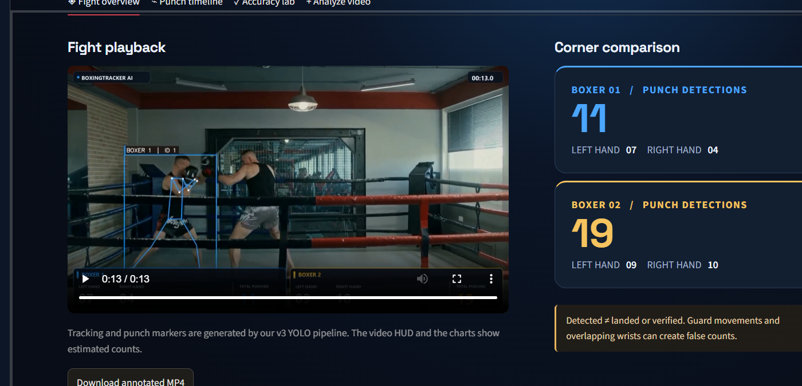
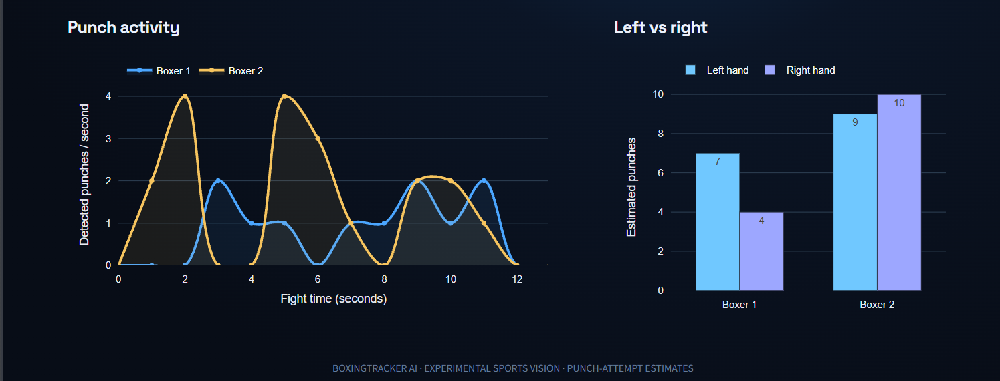
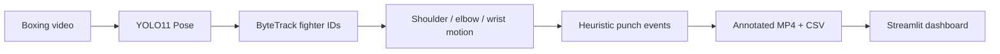

<p align="center">
  
</p>

<h1 align="center">BoxingTracker AI</h1>

<p align="center">
  <strong>Two-fighter pose tracking, punch-attempt detection, and interactive boxing analytics.</strong>
</p>

<p align="center">
  <a href="https://boxingtracker-ai.streamlit.app/"></a>
  <a href="https://github.com/srabon-d-costa/BoxingTracker-AI"></a>
  
  
</p>

<p align="center">
  <a href="https://boxingtracker-ai.streamlit.app/"><strong>Launch the app</strong></a>
  &nbsp; | &nbsp;
  <a href="#quick-start"><strong>Run locally</strong></a>
  &nbsp; | &nbsp;
  <a href="#how-it-works"><strong>How it works</strong></a>
</p>

---

## Overview

**BoxingTracker AI** is a computer vision and sports analytics prototype that follows **two boxers** in a video, estimates **left- and right-hand punch attempts** for each fighter, and presents the results in a polished Streamlit dashboard. The pipeline combines **YOLO11 Pose**, **ByteTrack**, a custom wrist-motion counting heuristic, **OpenCV**, and **Plotly**.

The app includes a ready-to-view boxing demonstration and an interface for analyzing your own MP4 clips. All punch counts are **experimental model outputs**, not confirmed landed strikes or measured accuracy.

## Features

| Feature | What it does |
| --- | --- |
| **Two-boxer tracking** | Detects both fighters, draws pose skeletons and bounding boxes, and associates tracked IDs with Boxer 1 and Boxer 2. |
| **Left / right punch counters** | Estimates punch attempts separately for each boxer's anatomical left and right hands. |
| **Annotated fight replay** | Exports an MP4 with fighter labels, motion overlays, a broadcast-style scoreboard, and punch notifications. |
| **Fight overview** | Compares fighter totals and shows the analyzed video inside a dark, responsive dashboard. |
| **Punch timeline** | Displays timestamped detections and discrete one-second punch activity. |
| **Accuracy lab** | Lets you review predictions, add manual ground-truth timestamps, and calculate precision/recall/F1 after full annotation. |
| **New video analysis** | Accepts an MP4, processes it with the same detector, and generates its own replay and CSV outputs. |

## Demo results

The bundled **13.04-second, 25 FPS** sparring clip produces the following **estimated punch detections** using the v3 baseline:

| Fighter | Left hand | Right hand | Total |
| :--- | ---: | ---: | ---: |
| **Boxer 1** | 7 | 4 | **11** |
| **Boxer 2** | 9 | 10 | **19** |
| **Combined** | **16** | **14** | **30** |

> [!IMPORTANT]
> **30 is the number of algorithm detections, not a verified count of real punches.** Guard movement, blocks, uncertain wrist keypoints, overlapping fighters, and tracking-ID changes can cause false positives or missed punches. This project does **not** detect confirmed hits, score a boxing match, or recognize jab/cross/hook/uppercut classes.

### Punch analytics

<p align="center">
  
</p>

The timeline uses **actual one-second event bins**, rather than drawing a smooth curve through discrete punch counts.

## How it works



1. **Pose estimation:** YOLO11 extracts body keypoints for people detected in the video.
2. **Tracking:** ByteTrack helps associate the two fighters between frames.
3. **Motion features:** The detector measures each wrist's forward movement relative to its shoulder, along with elbow angle and reach, accounting for the fighter's direction.
4. **Counting:** A motion threshold, smoothing, and recovery state estimate distinct punch attempts.
5. **Analytics:** Timestamped events feed the video HUD, fighter comparisons, activity timeline, and review tools.

The current counter is a **rule-based heuristic on pretrained pose estimates**; it is not a separately trained punch classifier.

## Tech stack

| Layer | Tools |
| --- | --- |
| Language | Python |
| Pose estimation | Ultralytics YOLO11 Pose (`yolo11n-pose.pt`) |
| Multi-object tracking | ByteTrack |
| Video processing | OpenCV, FFmpeg / imageio-ffmpeg |
| Motion analysis | NumPy and custom punch-counting logic |
| Data analysis | Pandas |
| Dashboard and charts | Streamlit, Plotly |
| Video HUD | OpenCV, Pillow |

## Quick start

**Requirements:** Python 3.11 recommended, Git, and an internet connection for the initial model download. Local inference works on CPU, but a GPU may speed it up.

```bash
git clone https://github.com/srabon-d-costa/BoxingTracker-AI.git
cd BoxingTracker-AI
python -m pip install -r requirements.txt
python -m streamlit run app.py
```

The dashboard opens with the **bundled demo**, so no new model inference is needed to explore the sample.

### Run the punch counter on a local video

Place a suitable video at `videos/boxing.mp4`, then run:

```bash
python main.py --source videos/boxing.mp4 --show
```

The first inference run may download the YOLO11 pose weights. Outputs are saved under `outputs/`:

```text
outputs/
  annotated_boxing.mp4   # Video with tracking and punch HUD
  punch_events.csv       # Estimated punch events and timestamps
  punch_debug.csv        # Per-hand motion diagnostics
  summary.csv            # Boxer-wise left/right totals
```

### Analyze a new video in the dashboard

1. Open the **Analyze video** tab.
2. Upload an **MP4** (up to **150 MB** and **60 seconds**).
3. Choose the inference image size and motion threshold. The v3 baseline uses **960** and **0.34**; **640** is lighter for hosted CPU testing.
4. Select **Analyze uploaded fight**.
5. Review the annotated replay and results. Download the output before leaving the hosted session.

**Tip:** Try a steady 5-15 second clip with exactly two visible fighters. Camera cuts, tight clinches, and strong occlusion make tracking harder.

## Project structure

```text
BoxingTracker-AI/
  app.py                    # Streamlit UI, tabs, charts, and review tools
  main.py                   # Two-fighter tracking and v3 punch counter
  analytics.py              # Event aggregation and validation metrics
  media.py                  # Browser-compatible video conversion
  workflow.py               # Uploaded-video processing and run management
  requirements.txt
  packages.txt              # Linux system dependencies for deployment
  .streamlit/config.toml    # Dashboard theme and upload configuration
  assets/                   # README screenshots
  outputs/demo/             # Bundled example replay and CSV results
  videos/                   # Local input videos (normally not committed)
  runs/                     # Local per-upload results (Git-ignored)
  tests/                    # Analytics and workflow tests
```

## Validation: how to measure actual accuracy

The **Accuracy lab** is designed for manual evaluation rather than assuming the detector's results are correct.

1. Watch the original clip and label **every real punch attempt**, including those the model missed.
2. Record the timestamp, boxer number, and anatomical hand in a CSV:

   ```csv
   time_seconds,boxer,hand
   ```

3. Import the labels in the Accuracy lab and confirm that the entire clip was annotated.
4. Compare predictions against labels using timestamp matching (default tolerance: **0.24 s**) to calculate **precision, recall, and F1**.

Until that annotation is completed, **no validated punch-detection accuracy is claimed**.

## Deployment

**Live app:** https://boxingtracker-ai.streamlit.app/

This repository is configured for **Streamlit Community Cloud** using `app.py`, `requirements.txt`, `packages.txt`, and `.streamlit/config.toml`. The cloud deployment uses `BOXINGTRACKER_PUBLIC_MODE = "1"` in Streamlit secrets.

- The bundled demo can be played without running YOLO.
- Fresh uploads need CPU-intensive model inference and may exceed free-hosting resources.
- Hosted uploads/results are **temporary**; local runs can be retained on your machine.
- Browser-session separation is not a security guarantee. **Do not upload sensitive or private fight footage** to the public demo.

See [`DEPLOY_STREAMLIT.md`](DEPLOY_STREAMLIT.md) for the deployment walkthrough.

## Run tests

```bash
python -m unittest discover -s tests -v
```

The test suite covers event calculations, timestamp matching, upload checks, run handling, and replay conversion. Passing code tests does **not** establish punch-recognition accuracy on real fights.

## Limitations and next steps

- **Video-based, not live webcam:** the current web app analyzes uploaded files.
- **Two fighters:** the tracking logic expects two primary boxers; IDs can switch after occlusion.
- **Punch attempts only:** no landed-hit detection or punch-type classification.
- **2D pose constraints:** ring ropes, blocks, fast hand motion, and overlapping limbs can affect wrist estimates.
- **Planned improvement:** build a manually labeled boxing clip set and measure precision/recall before tuning counting rules.

## Acknowledgments and media use

Built with [Ultralytics](https://github.com/ultralytics/ultralytics), [Streamlit](https://streamlit.io/), [OpenCV](https://opencv.org/), and [Plotly](https://plotly.com/python/).

The included example footage and generated video are **demo assets**. Verify the original clip's license and redistribution permission before reusing them outside this repository. Third-party libraries and models retain their own license terms.

---

<p align="center">
  Made for exploring the intersection of <strong>computer vision, movement analysis, and sports analytics</strong>.
  <br />
  <a href="https://boxingtracker-ai.streamlit.app/">Try BoxingTracker AI</a>
  &nbsp; | &nbsp;
  <a href="https://github.com/srabon-d-costa/BoxingTracker-AI/issues">Feedback and issues</a>
</p>
